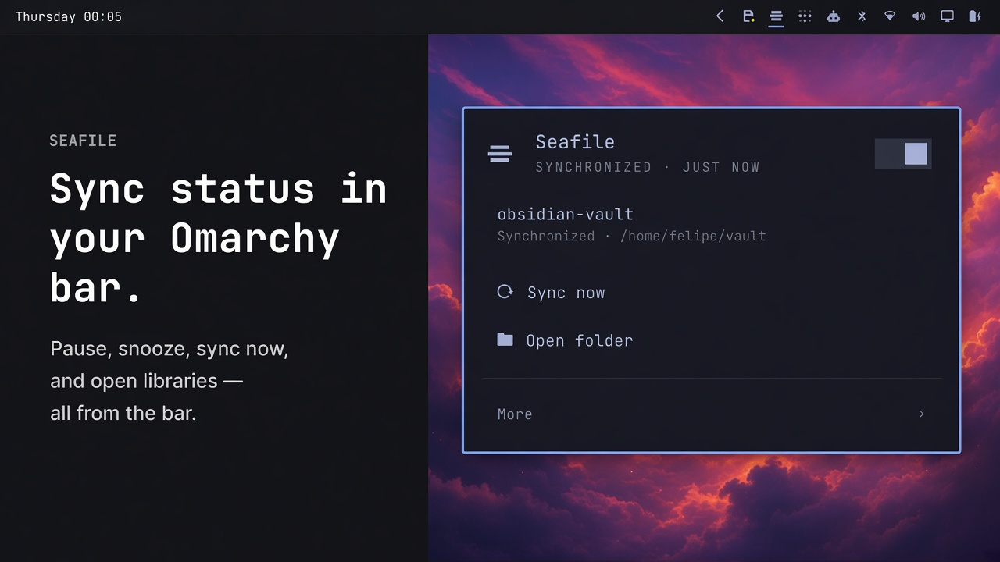
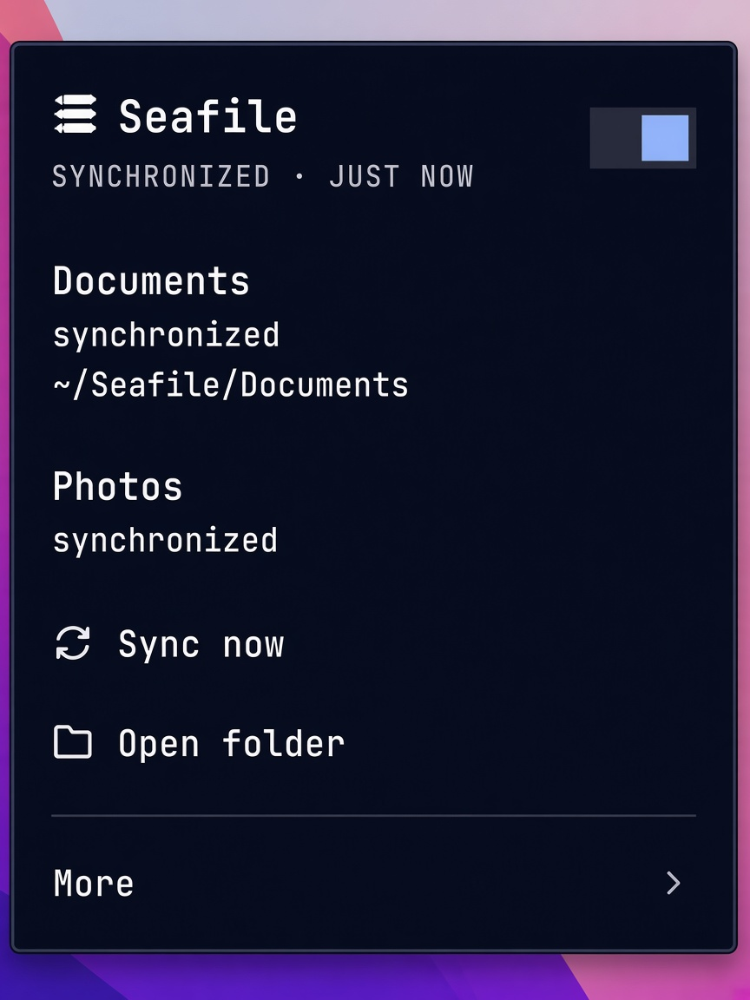

# Seafile for Omarchy

A bar widget for [Seafile](https://www.seafile.com/) on [Omarchy](https://omarchy.org/).

It sits on top of `seaf-cli`: live status in the bar, sync now, pause and snooze, open the library folder, view logs, and a terminal wizard to connect or repair a library binding.

---

## Preview





---

## Install

```bash
omarchy plugin add https://github.com/juangalt/omarchy-seafile-plugin.git --enable
```

SSH also works if you prefer keys over HTTPS:

```bash
omarchy plugin add git@github.com:juangalt/omarchy-seafile-plugin.git --enable
```

Requires the [`seafile`](https://archlinux.org/packages/extra/x86_64/seafile/) package (`seaf-cli`). The panel can install it with `yay` if it is missing.

---

## Remove

```bash
omarchy plugin disable juangalt.seafile
omarchy plugin remove juangalt.seafile
```

Removal deletes the plugin checkout. It does not uninstall the `seafile` package or erase `~/.seafile-client` library data.

---

## Use

| Input | Action |
| --- | --- |
| Left-click | Open the panel |
| Middle-click | Sync now (also restarts a stuck daemon) |
| Right-click | Refresh status |
| `s` / `p` | Sync now / pause·resume (panel focused) |

| Control | Behavior |
| --- | --- |
| Pause | Stops the Seafile daemon (and your user `seaf-daemon.service` if present) |
| Snooze 15m / 1h | Pause, then auto-resume |
| Connect / repair | Terminal wizard under **More** — re-attach a leftover binding (password only when needed), or a full sign-in |

Server URLs need a scheme (`https://…` or `http://…`). The wizard adds `https://` if you omit it, and asks before using cleartext HTTP.

---

## How Connect works

1. Starts the daemon if needed and ensures a valid **40-character hex** `client_id` (Seafile rejects anything else on download permission-check), kept in sync with `~/.seafile-client/seafile-data/id`.
2. **Repair (leftover binding):** confirms the saved library, server, folder, and account; reuses that identity; tries the saved library token first; if the token is missing or rejected, prompts only for the **account password** (and 2FA if you use it). Changing the server URL is opt-in (default No). An invalid leftover URL forces an edit instead of failing silently.
3. **Fresh Connect:** asks for server URL, username, and password, then lists remote libraries to sync or download.
4. Queues `seaf-cli sync` / `download`, clears stuck clone tasks if needed, and **waits until the library appears locally** before declaring success — `seaf-cli` alone only queues the clone.

If `seaf-cli` was initialized earlier but no library is linked yet, the bar may already look “configured.” Use **More → Connect / repair** to finish binding. The same path fixes **Needs re-attach** / **Library unbound** after a hard stop mid-sync (logout/reboot while uploading can leave empty local metadata while your files on disk stay intact).

Setup log (directory mode `700`, file mode `600`):

`~/.local/state/omarchy/plugins/juangalt.seafile/setup.log`

The account password is never stored. Login yields a short-lived account token handed to `seaf-cli` in a mode-`600` config file (`-C`), not as `-T`. An encrypted library password is written to `seaf-cli`'s stdin, not as `-e`. Neither is written to the log. Account email and server URL may be.

---

## Cloudflare and public hosts

Hosts behind Cloudflare (for example `https://seafile.zombie.enterprises`) sometimes block Python’s default User-Agent with error **1010**.

The Connect wizard runs `seaf-cli` through a small wrapper that sends a normal browser User-Agent for API calls (login, list-remote, download-info). The daemon’s own file transfer uses Seafile’s native client headers — that path does not need the wrapper.

---

## Important

- **One Seafile client.** Do not run `seafile-client` (GUI) alongside this. Both use the same data directory and will fight.
- **Pause stops the whole daemon**, not a single library.
- Prefer a full URL with scheme. LAN HTTP is allowed after an explicit confirm.
- After logout or reboot during an active upload, open **Connect / repair** if the bar says the library is unbound — re-attach the same folder; do not download into a new empty path unless you intend a fresh copy.

---

## Development

```bash
git clone git@github.com:juangalt/omarchy-seafile-plugin.git
cd omarchy-seafile-plugin
# edit, then:
omarchy plugin update juangalt.seafile
# or symlink the clone into ~/.config/omarchy/plugins/juangalt.seafile
```

Validate:

```bash
omarchy plugin validate .
bash -n scripts/setup.sh
python3 -m py_compile helper.py scripts/seaf_cli_ua.py
node test/model.test.js
python3 test/helper_unit.py
bash test/argv_secrets.sh
```

---

## License

MIT — see [LICENSE](LICENSE).
