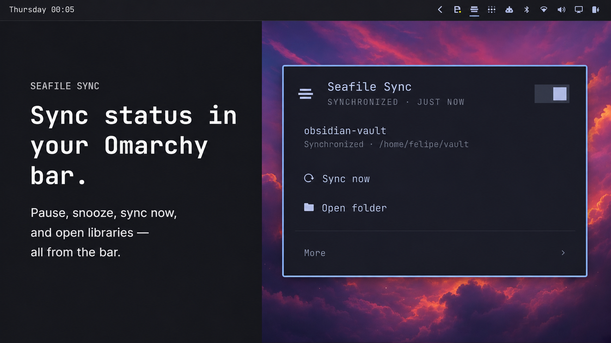
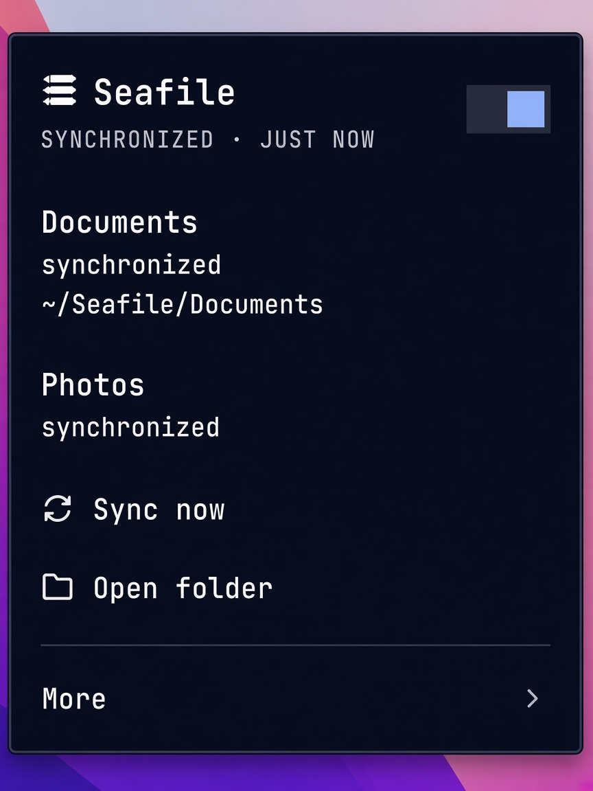

# Seafile Sync for Omarchy

Monitor and control [Seafile](https://www.seafile.com/) from your [Omarchy](https://omarchy.org/) bar. Check library status, sync on demand, and manage automatic syncing from one panel.

Seafile Sync builds on Seafile's command-line client (`seaf-cli`) with desktop controls for everyday use and a guided terminal wizard for connecting libraries and repairing broken connections.

## Features

- **Status at a glance:** see sync activity, paused libraries, errors, and when a library last synced.
- **Sync when you need it:** request a sync from the panel or middle-click the bar icon. Sync now also attempts to recover a stuck daemon.
- **Pause or snooze:** pause all syncing, resume it, or take a 15-minute or one-hour break with automatic resume while the plugin is enabled.
- **Per-library controls:** enable or disable automatic syncing and choose between syncing on change or at a set interval.
- **Folders and logs within reach:** open a library's local folder or inspect the Seafile log from the panel.
- **Guided connection and repair:** connect a server, choose a library, or reattach an existing folder using saved account details where available. Supports accounts with 2FA and encrypted libraries.

---

## Preview





---

## Install

```bash
omarchy plugin add https://github.com/juangalt/omarchy-seafile-plugin.git --enable
```

To install using your GitHub SSH key:

```bash
omarchy plugin add git@github.com:juangalt/omarchy-seafile-plugin.git --enable
```

Requires the [`seafile`](https://archlinux.org/packages/extra/x86_64/seafile/) package (`seaf-cli`). The panel can install it with `yay` if it is missing.

Runtime dependencies are Omarchy's Quickshell shell and shared `qs.Commons` / `qs.Ui` components, Bash, Python 3, `seaf-cli`, and the Python `seafile` and `pysearpc` modules. Connect / repair also uses `gum`, `sqlite3`, GNU coreutils (including `timeout`), `awk`, `grep`, `sed`, and `setsid` from util-linux. Opening folders uses `xdg-open`; viewing logs uses `less`. These tools are normally available on Omarchy; `yay` is needed only for the panel's optional Seafile package installer.

The plugin uses the English translation catalog as a fallback for other Omarchy languages.

---

## Remove

```bash
omarchy plugin disable juangalt.seafile
omarchy plugin remove juangalt.seafile
```

Removal deletes the plugin checkout. It does not uninstall the `seafile` package or erase `~/.seafile-client` library data.

Disabling or removing the plugin leaves the daemon in its current state. Resume a paused or snoozed client before removal, or run `seaf-cli start` afterward; the plugin cannot wake an expired snooze while disabled.

---

## Use

| Input | Action |
| --- | --- |
| Left-click | Open the panel |
| Middle-click | Sync now (also restarts a stuck daemon) |
| Right-click | Refresh status |
| `s` / `p` | Sync now / pause or resume (main panel focused) |

| Control | Behavior |
| --- | --- |
| Pause | Stops the Seafile daemon (and your user `seaf-daemon.service` if present) |
| Snooze 15m / 1h | Pause, then auto-resume |
| Sync settings | Per-library auto sync and check interval (on change, or poll every N minutes) |
| Connect / repair | Guided terminal setup under **More** — connect a library or reattach an existing folder |

Server URLs need a scheme (`https://…` or `http://…`). The wizard adds `https://` if you omit it, and asks before using cleartext HTTP.

---

## How Connect works

1. Starts the daemon if needed and ensures a valid **40-character hex** `client_id` (Seafile rejects anything else on download permission-check), kept in sync with `~/.seafile-client/seafile-data/id`.
2. **Repair (leftover binding):** confirms the saved library, server, folder, and account; reuses that identity; tries the saved library token first; if the token is missing or rejected, prompts only for the **account password** (and 2FA if you use it). Changing the server URL is opt-in (default No). An invalid leftover URL forces an edit instead of failing silently.
3. **Fresh Connect:** asks for server URL, username, and password, then lists remote libraries to sync or download.
4. Queues `seaf-cli sync` / `download`, clears stuck clone tasks if needed, and **waits until the library appears locally** before declaring success — `seaf-cli` alone only queues the clone.

If `seaf-cli` was initialized earlier but no library is linked yet, the bar may already look “configured.” Use **More → Connect / repair** to finish binding. The same path fixes **Needs re-attach** / **Library unbound** after a hard stop mid-sync (logout/reboot while uploading can leave empty local metadata while your files on disk stay intact).

Setup log (directory mode `700`, file mode `600`):

`~/.local/state/omarchy/plugins/juangalt.seafile/setup.log`

The wizard does not save your account password. It passes the login token to `seaf-cli` through a temporary, owner-only config file and removes that file on exit. Encrypted library passwords are passed through stdin. These credentials stay out of process arguments and setup logs; the account email and server URL may appear in logs. Seafile retains its own library authentication metadata in the client database.

---

## Cloudflare and public hosts

Some hosts behind Cloudflare block Python's default User-Agent with error **1010**.

The Connect wizard runs `seaf-cli` through a small wrapper that sends a normal browser User-Agent for API calls (login, list-remote, download-info). The daemon’s own file transfer uses Seafile’s native client headers — that path does not need the wrapper.

---

## Important

- **Use one client at a time.** Running the Seafile GUI alongside this plugin can cause conflicts because both use the same client data directory.
- **Pause stops the whole daemon**, not a single library. To pause one library only, use **More → Sync settings → Auto sync**.
- **On change** is the normal mode for local folders. Use a poll interval only for network mounts where filesystem events are unreliable.
- Prefer a full URL with scheme. LAN HTTP is allowed after an explicit confirm.
- After logout or reboot during an active upload, open **Connect / repair** if the bar says the library is unbound — re-attach the same folder; do not download into a new empty path unless you intend a fresh copy.

## Files and network access

The enabled widget checks local Seafile status every 15 seconds by default (configurable from 5 to 3600 seconds), with additional local checks after actions and during snooze. Status checks read the client configuration, library database, and log; they do not make direct server requests. The Seafile daemon handles network syncing according to its library settings.

Connect / repair contacts the server you select to authenticate and list or attach libraries. It initializes client metadata when needed, repairs the client ID, and can clear a stuck clone task for the selected library. Pause and resume control the current user's Seafile daemon and `seaf-daemon.service` when present. Plugin state and setup logs live under `~/.local/state/omarchy/plugins/juangalt.seafile/`; client metadata lives under `~/.ccnet` and `~/.seafile-client`. Removing the plugin preserves these directories and synced folders.

---

## Development

```bash
git clone git@github.com:juangalt/omarchy-seafile-plugin.git
cd omarchy-seafile-plugin
# edit, then:
omarchy plugin update juangalt.seafile
# or symlink the clone into ~/.config/omarchy/plugins/juangalt.seafile
```

Validate:

```bash
omarchy plugin validate .
bash -n scripts/setup.sh
python3 -m py_compile helper.py scripts/seaf_cli_ua.py
node test/model.test.js
python3 test/helper_unit.py
bash test/argv_secrets.sh
```

---

## License

MIT — see [LICENSE](LICENSE).
